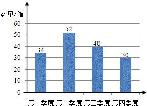

# Mathematics (Grade 6)

**ID**: e23d32aa
**难度**: hard
**题型**: fill_in_the_blank

## 题目
下面是百佳商场某种饮料四个季度销售量统计图．
①第______季度的销售量最多，比最少的多______箱；
②四个季度共销售多少箱？
③平均每个季度销售______箱．
④请提出一个数学问题或把发现的信息写一条．(不要求解答)

## 解答

**答案**: 二, 22, 156, 39

1. Step1:观察统计图可知第二季度销售量为52箱，是四个季度中最多的，第四季度销售量为30箱，是最少的，计算第二季度比第四季度多的箱数，即52 - 30 = 22箱，所以第一个空填二，第二个空填22
2. Step2:计算四个季度销售总量，将四个季度销售量相加，34 + 52 + 40 + 30 = 156箱，所以四个季度共销售156箱
3. Step3:计算平均每个季度销售量，用四个季度销售总量除以季度数4，156÷4 = 39箱，所以平均每个季度销售39箱

## 知识点

**知识点**:
  - 以一当五(或以上)的条形统计图;从统计图表中获取信息．

---
