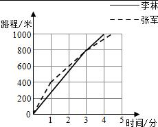

# Mathematics (Grade 6)

**ID**: e2d06c82
**难度**: hard
**题型**: fill_in_the_blank

## 题目
李林和张军两人进行1000米长跑比赛．如图中的两条折线分别表示两人途中的情况．看图回答问题．
（1）跑完1000米，李林用（  ）分，张军大约用（  ）分．
（2）起跑后的第1分，（  ）跑的速度快些．
（3）起跑后的第（  ）分，两人跑的路程同样多，大约是（  ）米．
（4）在这次比赛中，李林平均每分钟跑（  ）米．

## 解答

**答案**: 4, 4.5, 张军, 3, 800, 250

1. Step1:观察折线统计图，李林跑完1000米对应的时间刻度为4分，所以李林跑完1000米用4分
2. Step2:观察折线统计图，张军跑完1000米对应的时间刻度大约为4.5分，所以张军跑完1000米大约用4.5分
3. Step3:查看起跑后第1分钟，张军跑的路程为400米，李林大约跑280米，因为400米大于280米，所以起跑后的第1分，张军跑的速度快些
4. Step4:观察折线统计图，在起跑后的第3分钟，代表李林和张军的折线相交，此时两人跑的路程同样多，交点对应的路程大约是800米
5. Step5:已知李林跑的路程为1000米，时间为4分钟，根据路程÷时间=速度，可得1000÷4 = 250米，所以在这次比赛中，李林平均每分钟跑250米

## 知识点

**知识点**:
  - 单式折线统计图；从统计图表中获取信息．

---
