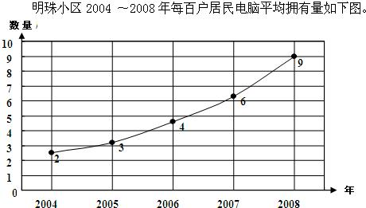

# Mathematics (Grade 6)

**ID**: e571892d
**难度**: hard
**题型**: fill_in_the_blank

## 题目
“实践操作”显身手．
（1）幸福小区2多多七～2多多8年每百户居民电脑平均拥有量一共增加了$\underline{\hspace{5em}}$台．
（2）$\underline{\hspace{5em}}$年到$\underline{\hspace{5em}}$&nbzp年这一年电脑平均拥有量增长的幅度最小．$\underline{\hspace{5em}}$年到$\underline{\hspace{5em}}$年这一年电脑平均拥有量增长的幅度最大．
（3）根据图中的信息预测，2多多9年幸福小区每百人电脑平均拥有量大约$\underline{\hspace{5em}}$台．

## 解答

**答案**: 7, 2002, 2001, 2007, 2002, 12

1. Step1:确定2004年每百户居民电脑平均拥有量为2台，2008年每百户居民电脑平均拥有量为9台，用9 - 2 = 7，得到2004～2008年每百户居民电脑平均拥有量一共增加的台数为7台
2. Step2:计算2004 - 2005年电脑平均拥有量增长3 - 2 = 1台，2005 - 2006年增长4 - 3 = 1台，2006 - 2007年增长6 - 4 = 2台，2007 - 2008年增长9 - 6 = 3台，比较得出2004 - 2005年增长幅度最小
3. Step3:根据上一步计算结果，得出2007 - 2008年增长幅度最大
4. Step4:因为2007 - 2008年每百户居民电脑平均拥有量增加了3台，且一直呈增长趋势，所以预测2009年每百户居民电脑平均拥有量大约为9 + 3 = 12台

## 知识点

**知识点**:
  - 统计图表的综合分析、解释和应用；从统计图表中获取信息．

---
