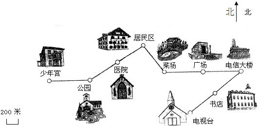

# Mathematics (Grade 6)

**ID**: e586acee
**难度**: hard
**题型**: fill_in_the_blank

## 题目
3路车路线图

（1）医院在居民区的$\underline{\hspace{5em}}$偏$\underline{\hspace{5em}}$的方向上，在公园的$\underline{\hspace{5em}}$偏$\underline{\hspace{5em}}$的方向上．
（2）3路车从少年宫出发，向$\underline{\hspace{5em}}$行驶$\underline{\hspace{5em}}$米到公园，再向$\underline{\hspace{5em}}$偏$\underline{\hspace{5em}}$行驶经过$\underline{\hspace{5em}}$站到居民区．
（3）小红从电信大楼上车，行驶了2站下车，她会在$\underline{\hspace{5em}}$站下车．

## 解答

**答案**: 西, 南, 东, 北, 东, 500, 东, 北, 2, 菜场或电视台

1. Step1:根据上北下南，左西右东的方位辨别法，判断医院相对于居民区的方位，可得医院在居民区的西偏南方向
2. Step2:同样根据方位辨别法，判断医院相对于公园的方位，可知医院在公园的东偏北方向
3. Step3:观察路线图，3路车从少年宫出发，其行驶方向是向东，根据图中比例尺，每段代表200米，从少年宫到公园有2.5段，200×2.5 = 500米，所以向东行驶500米到公园
4. Step4:从公园到居民区，其行驶方向是东偏北，数经过的站点数为2站
5. Step5:小红从电信大楼上车，行驶2站下车，向前数2站是菜场，向后数2站是电视台，所以她会在菜场或电视台站下车

## 知识点

**知识点**:
  - 路线图．

---
