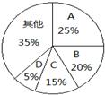

# Mathematics (Grade 6)

**ID**: e610037e
**难度**: hard
**题型**: fill_in_the_blank

## 题目
如图是欣欣超市今年五月份瓶装水各品牌占有率统计图．
（1）A品牌瓶装水的销售量是B品牌的 $\underline{\hspace{5em}}$ %．
（2）B品牌比C品牌多售出$\frac{()}{()}$．
（3）如果A品牌瓶装水售出125箱，那么五月份一共售出了 $\underline{\hspace{5em}}$ 箱．
（4）判断：所有品牌中，A品牌瓶装水一定最畅销． $\underline{\hspace{5em}}$ ．

## 解答

**答案**: 125, 1/3, 500, ×

1. Step1:求A品牌瓶装水的销售量是B品牌的百分之几，用A品牌所占百分率25%除以B品牌所占百分率20%，即25%÷20%=125%
2. Step2:求B品牌比C品牌多售出几分之几，先算出B品牌比C品牌多的百分率为20%-15%，再除以C品牌所占百分率15%，即(20%-15%)÷15%=5%÷15%=$\frac{1}{3}$
3. Step3:已知A品牌瓶装水售出125箱，A品牌所占百分率为25%，根据百分数除法意义，用125除以25%可得五月份一共售出的箱数，即125÷25%=500箱
4. Step4:因为其他占35%，其中可能有品牌的销售量超过A品牌的25%，所以不能确定A品牌瓶装水一定最畅销，答案为×

## 知识点

**知识点**:
  - 扇形统计图;从统计图表中获取信息

---
