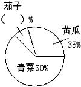

# Mathematics (Grade 6)

**ID**: e934a5a9
**难度**: hard
**题型**: fill_in_the_blank

## 题目
看图填空：
(1)茄子占总面积的______%，茄子的占地面积是92平方分米，黄瓜的占地面积是______平方分米，青菜的占地面积是______平方分米．
(2)在扇形统计图中表示黄瓜数量的圆心角是______度．

## 解答

**答案**: 5, 644, 1104, 126

1. Step1:把菜地总面积看作单位“1”，计算茄子占总面积的百分比，1 - 35% - 60% = 5%
2. Step2:已知茄子占地面积为92平方分米，根据茄子面积和占比求出菜地总面积，92÷5%
3. Step3:用菜地总面积乘黄瓜占总面积的35%，求出黄瓜占地面积，92÷5%×35% = 644平方分米
4. Step4:用菜地总面积乘青菜占总面积的60%，求出青菜占地面积，92÷5%×60% = 1104平方分米
5. Step5:计算在扇形统计图中表示黄瓜数量的圆心角，360°×35% = 126°

## 知识点

**知识点**:
  - 扇形统计图;百分数的实际应用．

---
