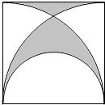

# Mathematics (Grade 6)

**ID**: eb840f9c
**难度**: hard
**题型**: fill_in_the_blank

## 题目
在边长为300厘米的正方形 中，如图放置了两个直角扇形和一个半圆，那么两块阴影部分的面积差是 $\underline{\hspace{5em}}$ 平方厘米，两块阴影部分的周长差是 $\underline{\hspace{5em}}$ 厘米．（π取3.14）

## 解答

**答案**: 15975, 485

1. Step1:设图中各部分区域为①②③④⑤，根据图形与面积关系可知，扇形ABC的面积$S_{扇形ABC}$=①+②+③，扇形BCD的面积$S_{扇形BCD}$=②+③+④，正方形ABCD的面积$S_{正方形ABCD}$=①+②+③+④+⑤
2. Step2:计算两块阴影部分面积差，由$S_{扇形ABC}$+$S_{扇形BCD}$-$S_{正方形ABCD}$=②+③-⑤，可得③-⑤=$S_{扇形ABC}$+$S_{扇形BCD}$-$S_{正方形ABCD}$-②，将数值代入，$S_{扇形ABC}$=3.14×300$^{2}$÷4，$S_{扇形BCD}$=3.14×300$^{2}$÷4，$S_{正方形ABCD}$=300×300，②的面积为3.14×（300÷2）$^{2}$÷2，计算得出3.14×90000÷4+3.14×90000÷4-300×300-3.14×22500÷2=70650+70650-90000-35325=15975平方厘米
3. Step3:连结BE、CE，因为BC=BE=CE，所以三角形BCE是等边三角形，进而得出扇形BCE的圆心角是60°，扇形CED的圆心角是30°
4. Step4:计算阴影部分③的周长，根据弧长公式，其周长为$\frac{1}{3}$×3.14×300×2+3.14×300÷2=628+471=1099厘米
5. Step5:计算阴影部分⑤的周长，根据弧长公式，其周长为$\frac{1}{6}$×3.14×300×2+300=314+300=614厘米
6. Step6:计算两块阴影部分周长差，1099 - 614 = 485厘米

## 知识点

**知识点**:
  - 圆与组合图形

---
