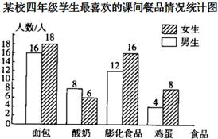

# Mathematics (Grade 6)

**ID**: f06a3bc0
**难度**: hard
**题型**: fill_in_the_blank

## 题目
观察如图的统计图，并回答问题．
（1）图中纵轴一小格表示$\underline{\hspace{5em}}$人．
（2）该校四年级男生一共有$\underline{\hspace{5em}}$人
（3）喜欢面包的女生比男生多$\underline{\hspace{5em}}$%．
（4）女生喜欢鸡蛋的比喜欢膨化食品的少$\underline{\hspace{5em}}$%．

## 解答

**答案**: 2, 40, 12.5, 50

1. Step1:观察统计图纵轴刻度，可知纵轴一小格表示2人
2. Step2:将表示男生人数的浅色直条数据16、8、12、4相加，即16+8+12+4=40，得出该校四年级男生一共有40人
3. Step3:先计算喜欢面包的女生比男生多的人数18 - 16 = 2，再用多的人数除以喜欢面包的男生人数，即2÷16 = 12.5%，得出喜欢面包的女生比男生多12.5%
4. Step4:先计算女生喜欢鸡蛋的比喜欢膨化食品的少的人数16 - 8 = 8，再用少的人数除以喜欢膨化食品的女生人数，即8÷16 = 50%，得出女生喜欢鸡蛋的比喜欢膨化食品的少50%

## 知识点

**知识点**:
  - 以一当二的条形统计图；从统计图表中获取信息．

---
