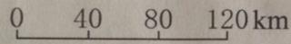

# Mathematics (Grade 6)

**ID**: f15d5536
**难度**: hard
**题型**: fill_in_the_blank

## 题目
(1)

 0  40  80  120km
 是(    )比例尺，它表示图上1cm的距离相当于实际距离(    )，用数值比例尺表示是(    )．
 (2)根据(    )的基本性质，可以把4:9改写成8:18；根据(    )的基本性质，可以把4:9=8:18改写成4×18=9×8．

## 解答

**答案**: 线段, 40km, 1:4000000, 比, 比例

1. Step1:观察题目中所给的0  40  80  120km形式，可知其为线段比例尺
2. Step2:根据线段比例尺的含义，得出图上1cm的距离相当于实际距离40km
3. Step3:因为1km = 100000cm，所以40km = 4000000cm，根据数值比例尺的定义，可得数值比例尺为1:4000000
4. Step4:根据比的基本性质，即比的前项和后项同时乘或除以（0除外）相同的数，比值不变，所以可以把4:9改写成8:18
5. Step5:根据比例的基本性质，即在比例里，两个外项的积等于两个内项的积，所以可以把4:9=8:18改写成4×18=9×8

## 知识点

**知识点**:
  - 

---
