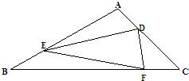

# Mathematics (Grade 6)

**ID**: f18fa4c8
**难度**: hard
**题型**: fill_in_the_blank

## 题目
将三角形ABC，AB四等分，BC五等分，AC三等分（如下图所示）那么，$\frac{三角形DEF的面积}{三角形ABC的面积}$=$\underline{\hspace{5em}}$．

## 解答

**答案**: $\frac{5}{12}$

1. Step1:连接AF、BD、CE。
2. Step2:因为D是AC的三等分点，根据高一定时，三角形的面积与底成正比例的性质，得出三角形DFC = $rac{2}{3}$三角形AFC；又因为F是BC的五等分点，所以三角形AFC = $rac{1}{5}$三角形ABC，进而得到三角形DFC = $rac{2}{3}$×$rac{1}{5}$三角形ABC = $rac{2}{15}$三角形ABC。
3. Step3:同理，因为D是AC的三等分点，AB四等分，得出三角形ADE = $rac{3}{4}$×$rac{1}{3}$三角形ABC = $rac{1}{4}$三角形ABC。
4. Step4:同理，因为AB四等分，BC五等分，得出三角形BEF = $rac{1}{4}$×$rac{4}{5}$三角形ABC = $rac{1}{5}$三角形ABC。
5. Step5:计算三角形DFC、三角形ADE、三角形BEF的面积之和占三角形ABC面积的比例，即$rac{2}{15}$ + $rac{1}{4}$ + $rac{1}{5}$ = $rac{7}{12}$。
6. Step6:计算$rac{三角形DEF的面积}{三角形ABC的面积}$，用1减去上述比例，即1 - $rac{7}{12}$ = $rac{5}{12}$。

## 知识点

**知识点**:
  - 三角形面积与底的正比关系．

---
