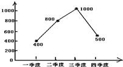

# Mathematics (Grade 6)

**ID**: f546ed77
**难度**: hard
**题型**: fill_in_the_blank

## 题目
某超市2011年各季度雪碧饮料销售情况如图所示．
（1）$\underline{\hspace{5em}}$季度销售量最大，$\underline{\hspace{5em}}$季度销售量最小．
（2）下半年比上半年多销售$\underline{\hspace{5em}}$瓶．
（3）全年平均每季度销售$\underline{\hspace{5em}}$瓶．
（4）第三季度比第一季度销售量增加$\underline{\hspace{5em}}$%．
（5）根据这个折线统计图，对此超市雪碧销售情况进行简要分析．

## 解答

**答案**: 第三季度, 第一季度, 300, 675, 150

1. Step1:观察折线统计图，可知第三季度对应的销售量数值最高，第一季度对应的销售量数值最低，所以第三季度销售量最大，第一季度销售量最小
2. Step2:上半年销售量为400 + 800 = 1200瓶，下半年销售量为1000 + 500 = 1500瓶，1500 - 1200 = 300瓶，所以下半年比上半年多销售300瓶
3. Step3:全年销售量为400 + 800 + 1000 + 500 = 2700瓶，2700÷4 = 675瓶，所以全年平均每季度销售675瓶
4. Step4:第三季度比第一季度多销售1000 - 400 = 600瓶，600÷400×100% = 150%，所以第三季度比第一季度销售量增加150%

## 知识点

**知识点**:
  - 单式折线统计图；从统计图表中获取信息；统计结果的解释和据此作出的判断和预测．

---
