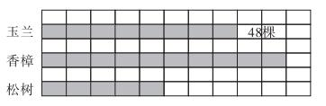

# Mathematics (Grade 6)

**ID**: fa01ba91
**难度**: hard
**题型**: fill_in_the_blank

## 题目
某校校园里玉兰、香樟和松树三种树木的棵数如下。

（1）香樟树比玉兰树多$\frac{1}{4}$， 香樟树比玉兰树多多少棵？
求香樟树比玉兰树多多少棵，就是求（）树的$\frac{（）}{（）}$，列式是（）×（）。
（2）松树比玉兰树少$\frac{3}{8}$，松树比玉兰树多多少棵？
求松树比玉兰树少多少棵，就是求（）树的$\frac{（）}{（）}$，列式是（）×（）。

## 解答

**答案**: 玉兰, 1, 4, 48, 1, 4, 玉兰, 3, 8, 48, 3, 8

1. Step1:对于（1），已知香樟树比玉兰树多$\frac{1}{4}$，把玉兰树棵数看作单位“1”，求香樟树比玉兰树多的棵数，就是求玉兰树的$\frac{1}{4}$，所以第一个空填玉兰
2. Step2:（1）中所求部分对应的分率是$\frac{1}{4}$，所以第二、三个空分别填1、4
3. Step3:已知玉兰树有48棵，根据“求一个数的几分之几是多少，用乘法计算”，所以（1）中列式为48×$\frac{1}{4}$，第四、五个空分别填48、1
4. Step4:（1）中列式为48×$\frac{1}{4}$，所以第六个空填4
5. Step5:对于（2），已知松树比玉兰树少$\frac{3}{8}$，把玉兰树棵数看作单位“1”，求松树比玉兰树少的棵数，就是求玉兰树的$\frac{3}{8}$，所以第七个空填玉兰
6. Step6:（2）中所求部分对应的分率是$\frac{3}{8}$，所以第八、九个空分别填3、8
7. Step7:已知玉兰树有48棵，根据“求一个数的几分之几是多少，用乘法计算”，所以（2）中列式为48×$\frac{3}{8}$，第十、十一个空分别填48、3
8. Step8:（2）中列式为48×$\frac{3}{8}$，所以第十二个空填8

## 知识点

**知识点**:
  - 分数乘法

---
