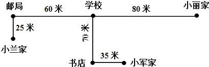

# Mathematics (Grade 6)

**ID**: face5e12
**难度**: hard
**题型**: fill_in_the_blank

## 题目
看图完成填空．

(1)小丽从家出发向______走______米到学校．
(2)小兰从家出发，先向______走______米到邮局，再向______走______米到学校．
(3)小军从家出发，先向______走______米到书店，再向______走______米到学校．
(4)______家离学校最近，______家离学校最远．

## 解答

**答案**: 西, 80, 北, 25, 东, 60, 西, 35, 北, 70, 小丽, 小军

1. Step1:根据‘上北下南、左西右东’，小丽家在学校东边，所以小丽从家出发向西走，图中显示距离为80米
2. Step2:小兰家在邮局南边，所以小兰从家出发先向北走25米到邮局，邮局在学校西边，所以再向东走60米到学校
3. Step3:小军家在书店东边，所以小军从家出发先向西走35米到书店，书店在学校南边，所以再向北走70米到学校
4. Step4:分别计算各人家到学校的距离，小丽家80米，小兰家25 + 60 = 85米，小军家35 + 70 = 105米，比较可得小丽家离学校最近，小军家离学校最远

## 知识点

**知识点**:
  - 路线图．

---
