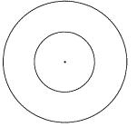

# Mathematics (Grade 6)

**ID**: fede1766
**难度**: hard
**题型**: fill_in_the_blank

## 题目
下图两个同心圆，小圆的半径是大圆半径的50%。

（1）大圆周长是小圆直径的（）倍，小圆周长是小圆直径的（）倍。
（2）大圆周长是小圆周长的（）倍，小圆面积是大圆面积的（）%。
（3）若这两个同心圆组成的环形面积是15cm$^{2}$，小圆面积是（）cm$^{2}$，大圆面积是（）cm$^{2}$。

## 解答

**答案**: 2π, π, 2, 25, 5, 20

1. Step1:根据圆的周长公式c=πd，可知小圆周长是小圆直径的π倍；设大圆半径为R，小圆半径为r，已知r = 0.5R，大圆直径D = 2R，小圆直径d = 2r = R，大圆周长C = πD = 2πR，所以大圆周长是小圆直径的2π倍
2. Step2:假设大圆半径为2，那么小圆半径为1，根据圆的周长公式c=πd，大圆周长为π×2×2，小圆周长为π×1×2，π×2×2÷(π×1×2)=2，所以大圆周长是小圆周长的2倍
3. Step3:根据圆的面积公式s=πr²，小圆面积为π×1²，大圆面积为π×2²，π×1²÷(π×2²)=25%，所以小圆面积是大圆面积的25%
4. Step4:已知环形面积是15cm²，环形面积是大圆面积的1 - 25% = 75%，则大圆面积为15÷75% = 20cm²
5. Step5:用大圆面积20cm²减去环形面积15cm²，得到小圆面积为20 - 15 = 5cm²

## 知识点

**知识点**:
  - 圆的面积;圆的周长

---
