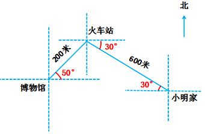

# Mathematics (Grade 6)

**ID**: 000eaacd
**难度**: hard
**题型**: multiple_choice

## 题目
如下图：小明和几个小朋友星期天从小明家出发骑车去博物馆参观，下面是他们所走的路线图。描述他们所走的正确的路线是（    ）。 

$\begin{description}
\item A．小明家——向西偏北30°方向走600米到火车站——从火车站向西偏南50°方向走200米。\item B．小明家——向北偏西30°方向走600米到火车站——从火车站向西偏南50°方向走200米。\item C．小明家——向西偏北30°方向走600米到火车站——从火车站向南偏西50°方向走200米。\item D．小明家——向北偏西30°方向走600米到火车站——从火车站向南偏西50°方向走200米。
\end{description}$

## 解答

**答案**: A

1. Step1:根据图上方向‘上北下南、左西右东’，确定从小明家出发，以小明家为出发点观察到火车站的方向是西偏北30°，距离是600米
2. Step2:再以火车站为出发点，观察到博物馆的方向是西偏南50°，距离是200米
3. Step3:对比各选项描述的路线，发现选项A符合上述描述

## 知识点

**知识点**:
  - 

---
