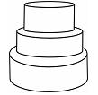

# Mathematics (Grade 6)

**ID**: 0233c85e
**难度**: hard
**题型**: multiple_choice

## 题目
如图，三个半径分别是1米、1.5米和2米的同轴圆柱，每个圆柱高0.5米，这三个圆柱组成一个立体图形，这个立体图形的表面积是（）。

A.25.12平方米       
B.36.11平方米              
C.39.25平方米              
D.42.39平方米

## 解答

**答案**: C

1. Step1:计算大圆柱的表面积，根据公式圆柱表面积 = 底面积×2 + 侧面积，底面积 = 3.14×半径²，侧面积 = 2×3.14×半径×高，大圆柱半径为2米，高为0.5米，可得3.14×2²×2 + 2×3.14×2×0.5 = 31.4平方米
2. Step2:计算中圆柱的侧面积，根据公式侧面积 = 2×3.14×半径×高，中圆柱半径为1.5米，高为0.5米，可得2×3.14×1.5×0.5 = 4.71平方米
3. Step3:计算小圆柱的侧面积，根据公式侧面积 = 2×3.14×半径×高，小圆柱半径为1米，高为0.5米，可得2×3.14×1×0.5 = 3.14平方米
4. Step4:计算这个立体图形的表面积，为大圆柱的表面积加上中、小圆柱的侧面积，即31.4 + 4.71 + 3.14 = 39.25平方米
5. Step5:得出答案，选项C符合

## 知识点

**知识点**:
  - 不规则立体图形表面积的计算(奥数)

---
