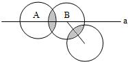

# Mathematics (Grade 6)

**ID**: 0f429252
**难度**: hard
**题型**: multiple_choice

## 题目
有三个面积都是S的圆放在桌上（如图），桌面被覆盖的面积是2S+2，并且重合的两块的面积相等，直线a过两个圆心A、B，如果直线a下方的被圆覆盖的面积是9，则S的值为（  ）
A．5
B．5.5
C．6
D．6.5

## 解答

**答案**: C

1. Step1:设每块阴影的面积是x，根据桌面被圆覆盖的面积=3个圆的面积-2倍的每块阴影面积，可得3S - 2x = 2S + 2
2. Step2:对3S - 2x = 2S + 2进行化简，3S - 2S = 2x + 2，从而得到S = 2 + 2x
3. Step3:分析直线a下方被圆覆盖的面积，为2个圆的面积 - 1.5倍的每块阴影面积，即2S - 1.5x = 9
4. Step4:把S = 2 + 2x代入2S - 1.5x = 9中，得到2×(2 + 2x) - 1.5x = 9
5. Step5:对2×(2 + 2x) - 1.5x = 9进行计算，4 + 4x - 1.5x = 9，进一步得到2.5x = 5，解得x = 2
6. Step6:把x = 2代入S = 2 + 2x，计算得出S = 2 + 2×2 = 6

## 知识点

**知识点**:
  - 重叠问题．

---
