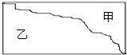

# Mathematics (Grade 6)

**ID**: 11a46f1f
**难度**: hard
**题型**: multiple_choice

## 题目
比较下面两个图形，（  ）种说法正确．

A．甲、乙的周长和面积都相等
B．甲、乙的周长和面积都不相等
C．甲的面积小于乙，它们的周长相等
D．它们不能比较

## 解答

**答案**: C

1. Step1:观察图形，可知甲的面积小于长方形面积的$\frac{1}{2}$，乙的面积大于长方形面积的$\frac{1}{2}$，所以得出甲的面积小于乙的面积
2. Step2:分析甲的周长，甲的周长等于长方形的两条邻边的和加上中间的曲线的长
3. Step3:分析乙的周长，乙的周长等于长方形的两条邻边的和加上中间的曲线的长
4. Step4:比较甲、乙的周长，得出甲的周长等于乙的周长
5. Step5:综合面积和周长的比较结果，可知甲的面积小于乙，它们的周长相等，所以答案选C

## 知识点

**知识点**:
  - 长度比较；面积及面积的大小比较．

---
