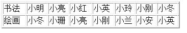

# Mathematics (Grade 6)

**ID**: 182dbf06
**难度**: hard
**题型**: multiple_choice

## 题目
 三（1）班参加书法、绘画比赛的学生名单如表，参加两个小组的学生是（  ） 
 A．小亮、小英、小冬  B．小明、小亮、小安  C．小红、小英、小刚 

## 解答

**答案**: A

1. Step1:观察表格中书法比赛的学生名单为小明、小亮、小红、小英、小玲、小刚、小冬
2. Step2:观察表格中绘画比赛的学生名单为小冬、小珊、小亮、小刚、小兰、小安、小英
3. Step3:对比两个比赛的学生名单，找出重复出现的学生，即小亮、小英、小冬
4. Step4:根据找出的同时参加两个小组的学生，与选项进行对比，得出答案为A

## 知识点

**知识点**:
  - 认识物体

---
