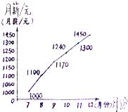

# Mathematics (Grade 6)

**ID**: 18c80646
**难度**: hard
**题型**: multiple_choice

## 题目
如图是内地某工厂工人的下半年月收入统计图，请问他的月薪增涨幅度最大的是(  )月．

A．8月
B．9月
C．12月
D．11月

## 解答

**答案**: D

1. Step1:计算7月到8月的月薪增长额，1100 - 1000 = 100元，再计算增幅为100÷1000 = 10%
2. Step2:计算8月到9月的月薪增长额，1170 - 1100 = 70元，再计算增幅为70÷1100≈6.36%
3. Step3:计算9月到10月的月薪增长额，1240 - 1170 = 70元，再计算增幅为70÷1170≈5.98%
4. Step4:计算10月到11月的月薪增长额，1300 - 1240 = 60元，再计算增幅为60÷1240 = 4.84%
5. Step5:计算11月到12月的月薪增长额，1450 - 1300 = 150元，再计算增幅为150÷1300 = 11.5%
6. Step6:比较各月增幅大小，11.5%＞10%＞6.36%＞5.98%＞4.84%
7. Step7:得出11月到12月月薪增涨幅度最大，答案选D

## 知识点

**知识点**:
  - 单式折线统计图．

---
