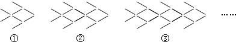

# Mathematics (Grade 6)

**ID**: 1b59b078
**难度**: hard
**题型**: multiple_choice

## 题目
为庆祝“六一”儿童节，某幼儿阅举行用火桨棒摆“金鱼”比赛，如图所示：

按照以上的规律，摆n个“金鱼”需要火柴棒的根数为（  ）
$\begin{description}
\item A．2+6n\item B．8+6n\item C．4+4n\item D．8n
\end{description}$

## 解答

**答案**: A

1. Step1:观察图形，发现图②的火柴棒比图①多6根，图③的火柴棒比图②多6根，得出每增加一个金鱼就增加6根火柴棒的规律
2. Step2:计算第一个金鱼需用火柴棒的根数为2 + 6 = 8
3. Step3:计算第二个金鱼需用火柴棒的根数为2 + 2×6 = 14
4. Step4:计算第三个金鱼需用火柴棒的根数为2 + 3×6 = 20
5. Step5:归纳得出第n个金鱼需用火柴棒的根数为2 + n×6 = 2 + 6n
6. Step6:根据得出的表达式，在选项中找到对应的答案为A

## 知识点

**知识点**:
  - 数与形结合的规律．

---
