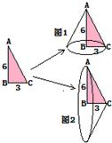

# Mathematics (Grade 6)

**ID**: 1bf62787
**难度**: hard
**题型**: multiple_choice

## 题目
(2013•江油市模拟)把三角形ABC沿着边AB或BC分别旋转一周，得到两个圆锥(如图1、图2)(  )的体积大？(单位：厘米)

A．图1
B．图2
C．无法确定谁

## 解答

**答案**: B

1. Step1:明确直角三角形两条直角边分别为3厘米和6厘米
2. Step2:确定以AB为轴旋转时，圆锥底面半径为3厘米，高为6厘米，根据圆锥体积公式v = 1/3sh，计算其体积为1/3×3.14×3²×6 = 56.52立方厘米
3. Step3:确定以BC为轴旋转时，圆锥底面半径为6厘米，高为3厘米，根据圆锥体积公式v = 1/3sh，计算其体积为1/3×3.14×6²×3 = 113.04立方厘米
4. Step4:比较两个圆锥体积大小，113.04＞56.52，得出图2体积大

## 知识点

**知识点**:
  - 圆锥的体积;作旋转一定角度后的图形．

---
