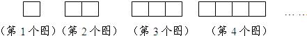

# Mathematics (Grade 6)

**ID**: 1cd6daa9
**难度**: hard
**题型**: multiple_choice

## 题目
按下面的方式摆正方形，摆1个正方形需要4根小棒，摆2个正方形需要7根小棒，摆20个正方形需要的小棒数是（  ）

A．80
B．49
C．58
D．61

## 解答

**答案**: D

1. Step1:分析摆正方形小棒数量规律，摆1个正方形用4根小棒，摆2个正方形时，在第1个4根基础上增加3根，即4 + 3×1 = 7根，摆3个正方形时，在第1个4根基础上增加2个3根，即4 + 3×2 = 10根
2. Step2:总结出摆n个正方形需要小棒数量的表达式为4 + 3×(n - 1)，化简得到3n + 1根
3. Step3:当n = 20时，将其代入表达式3n + 1，计算3×20 + 1 = 60 + 1 = 61根
4. Step4:对比选项，得出答案为D

## 知识点

**知识点**:
  - 数与形结合的规律．

---
