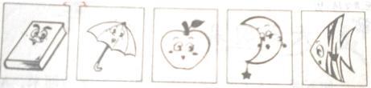

# Mathematics (Grade 6)

**ID**: 2548e1ff
**难度**: hard
**题型**: multiple_choice

## 题目
有五张卡片，分别画有下面的图形，将它们背面朝上洗匀后任意抽出一张，抽到雨伞的可能性是（  ）

$\begin{description}
\item A．\frac{1}{2}\item B．\frac{1}{4}\item C．\frac{1}{5}\item D．\frac{1}{6}
\end{description}$

## 解答

**答案**: C

1. Step1:明确问题是求从五张卡片中任意抽出一张，抽到雨伞卡片的可能性
2. Step2:根据求可能性的方法，用有雨伞的图形的数量除以图形的总量来计算可能性
3. Step3:已知有雨伞的图形数量为1，图形的总量为5
4. Step4:计算1÷5的结果为$rac{1}{5}$
5. Step5:对比选项，确定答案为C

## 知识点

**知识点**:
  - 简单事件发生的可能性求解．

---
