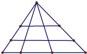

# Mathematics (Grade 6)

**ID**: 2e0c6057
**难度**: hard
**题型**: multiple_choice

## 题目
数一数，图中有（  ）个三角形．

A．30
B．18个
C．20
D．21

## 解答

**答案**: B

1. Step1:计算线段FG上的线段数量，根据线段数量计算公式可得3+2+1=6条
2. Step2:因为以A为顶点，线段FG上任何一条线段为底均可得到一个三角形，所以以线段FG上的各条线段为底边的三角形个数为6个
3. Step3:同理，以线段DE上的各条线段为底边的三角形个数也为6个
4. Step4:同理，以线段BC上的各条线段为底边的三角形个数同样为6个
5. Step5:计算图中三角形的总个数，6×3=18个
6. Step6:对比选项，答案为B

## 知识点

**知识点**:
  - 组合图形的计数．

---
