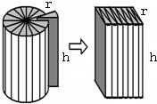

# Mathematics (Grade 6)

**ID**: 3231c073
**难度**: hard
**题型**: multiple_choice

## 题目
把一个圆柱体沿半径和高平均切成若干份以后，重新拼插成一个近似长方体，原来圆柱体的侧面积是81.64cm$^{2}$．长方体的表面积比圆柱体增加（  ）
A．24cm^{2}
B．26cm^{2}
C．32cm^{2}
D．16cm^{2}

## 解答

**答案**: B

1. Step1:根据解析2可知，圆柱侧面积公式为圆柱的侧面积 = 2πrh，已知圆柱侧面积是81.64cm²，所以可得rh = 侧面积÷2π，即rh = 81.64÷(2×3.14)
2. Step2:计算81.64÷(2×3.14) = 81.64÷6.28 = 13
3. Step3:由解析2可知，把圆柱体拼成近似长方体后，表面积增加了2rh平方厘米，已求得rh = 13，所以增加的面积为2×13 = 26平方厘米

## 知识点

**知识点**:
  - 简单的立方体切拼问题；长方体和正方体的表面积．

---
