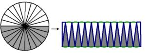

# Mathematics (Grade 6)

**ID**: 32894b05
**难度**: hard
**题型**: multiple_choice

## 题目
以下关于圆的说法错误的是（    ）。 

$\begin{description}
\item A.任意一个圆的周长与它的直径的比值是一个固定的数，我们把它叫做圆周率。\item B.用圆规画圆时，两脚张开的距离就是直径。\item C.生活中的车轮、大多数井盖采用圆形，是利用同一圆的半径都相等的性质。\item D.在硬纸上画一个圆，把圆分成若干（偶数）等份，剪开后，用这些近似于等腰三角形的小纸片拼成的图形接近于一个长方形，且近似的长方形面积等于这个圆的面积。
\end{description}$

## 解答

**答案**: B

1. Step1:分析选项A，根据圆周率的定义，任意一个圆的周长与它的直径的比值是一个固定的数，叫圆周率，所以选项A说法正确
2. Step2:分析选项B，用圆规画圆时，有针的一脚为圆心，有笔头的一脚旋转一周得圆，圆规两脚间的距离是圆的半径，不是直径，所以选项B说法错误
3. Step3:分析选项C，半径决定圆的大小，在同一个圆内有无数条半径且都相等，生活中的车轮、大多数井盖采用圆形，是利用同一圆的半径都相等的性质，所以选项C说法正确
4. Step4:分析选项D，把一个圆剪拼成近似长方形，长方形的长等于圆的周长的一半，宽等于圆的半径，圆的面积等于近似长方形的面积，所以选项D说法正确
5. Step5:综上，说法错误的是选项B，答案为B

## 知识点

**知识点**:
  - 

---
