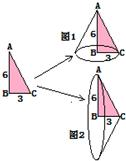

# Mathematics (Grade 6)

**ID**: 32a322a1
**难度**: hard
**题型**: multiple_choice

## 题目
把三角形ABC沿着边AB或BC分别旋转一周，得到两个圆锥（如图1、图2）（  ）的体积大？（单位：厘米）

$\begin{description}
\item A．图1\item B．图2\item C．无法确定谁
\end{description}$

## 解答

**答案**: B

1. Step1:明确直角三角形两条直角边分别为3厘米和6厘米，当以AB为轴旋转时，圆锥底面半径是3厘米，高是6厘米；以BC为轴旋转时，圆锥底面半径是6厘米，高是3厘米
2. Step2:根据圆锥体积公式v = $rac{1}{3}$sh，计算以AB为轴旋转所成圆锥的体积，即$rac{1}{3}$×3.14×3²×6 = $rac{1}{3}$×3.14×9×6 = 56.52立方厘米
3. Step3:根据圆锥体积公式v = $rac{1}{3}$sh，计算以BC为轴旋转所成圆锥的体积，即$rac{1}{3}$×3.14×6²×3 = $rac{1}{3}$×3.14×36×3 = 113.04立方厘米
4. Step4:比较两个圆锥体积大小，113.04＞56.52，得出图2的体积大

## 知识点

**知识点**:
  - 圆锥的体积；作旋转一定角度后的图形．

---
