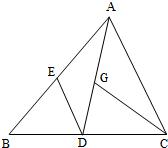

# Mathematics (Grade 6)

**ID**: 34f6c8c1
**难度**: hard
**题型**: multiple_choice

## 题目
如图，在三角形ABC中，E、D、G分别是AB、BC、AD的中点，图中与三角形ADE面积相等的三角形还有（  ）
$\begin{description}
\item A．0个\item B．1个\item C．2个\item D．3个
\end{description}$

## 解答

**答案**: D

1. Step1:已知E、D、G分别是AB、BC、AD的中点，根据高一定时，三角形的面积与底成正比例的性质，因为E是AB中点，所以三角形ADE和三角形BDE等底等高，可得三角形ADE的面积=三角形BDE的面积
2. Step2:因为D是BC中点，所以三角形ABD的面积是三角形ABC面积的一半，那么三角形ADE的面积=三角形BDE的面积=$rac{1}{2}$三角形ABD=$rac{1}{4}$三角形ABC
3. Step3:因为G是AD中点，所以三角形AGC和三角形DGC等底等高，可得三角形AGC的面积=三角形DGC的面积
4. Step4:因为D是BC中点，所以三角形ACD的面积是三角形ABC面积的一半，那么三角形AGC的面积=三角形DGC的面积=$rac{1}{2}$三角形ACD=$rac{1}{4}$三角形ABC
5. Step5:由前面步骤可知三角形ADE的面积=三角形BDE的面积=三角形AGC的面积=三角形DGC的面积，所以图中与三角形ADE面积相等的三角形有3个

## 知识点

**知识点**:
  - 三角形面积与底的正比关系．

---
