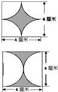

# Mathematics (Grade 6)

**ID**: 3557382d
**难度**: hard
**题型**: multiple_choice

## 题目
如图，关于两个图形中阴影部分的叙述正确的是（  ）

A．两个图形中阴影部分的周长相等，面积不相等
B．两个图形中阴影部分的周长和面积都相等
C．两个图形中阴影部分的周长不相等，面积相等
D．两个图形中阴影部分的周长和面积都不相等

## 解答

**答案**: C

1. Step1:观察图形可知两个正方形全等，其面积相等
2. Step2:发现两个图形中的空白处均可组成一个完整的半径相等的圆，根据圆的面积公式可知圆的面积相等
3. Step3:根据阴影部分的面积=正方形的面积 - 圆的面积，以及等量减去等量差相等的原理，得出两个图形中阴影部分的面积相等
4. Step4:计算第一个图形中阴影部分的周长，其为直径为4的圆的周长
5. Step5:计算第二个图形中阴影部分的周长，其为直径为4的圆的周长加上两条边长
6. Step6:比较两个图形中阴影部分的周长，得出周长不相等
7. Step7:综上，两个图形中阴影部分的周长不相等，面积相等，答案选C

## 知识点

**知识点**:
  - 面积及面积的大小比较；圆、圆环的周长；圆、圆环的面积．

---
