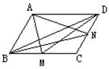

# Mathematics (Grade 6)

**ID**: 360eb290
**难度**: hard
**题型**: multiple_choice

## 题目
如图：MN分别为平行四边形相邻两边的中点，若平行四边形面积为1平方分米，那么图中面积为$\frac{1}{4}$平方分米的三角形有（  ）个．
$\begin{description}
\item A．3\item B．4\item C．5\item D．6
\end{description}$

## 解答

**答案**: D

1. Step1:明确平行四边形面积为1平方分米，目标是找面积为1/4平方分米的三角形
2. Step2:根据三角形面积公式，思考以平行四边形边的一半为底边的情况
3. Step3:发现以BC的一半为底边，以A、D点到BC垂线为高的三角形有△ABM、△DBM、△DCM
4. Step4:发现以CD的一半为底边，以A、B点到CD的垂线为高的三角形有△BCN、△AND、△BND
5. Step5:由三角形和平行四边形面积公式可知上述三角形面积是平行四边形面积的1/4，即为1/4平方分米
6. Step6:计算符合条件的三角形个数为3 + 3 = 6个

## 知识点

**知识点**:
  - 三角形面积与底的正比关系；组合图形的计数．

---
