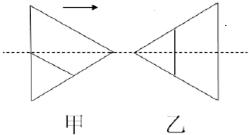

# Mathematics (Grade 6)

**ID**: 3acde914
**难度**: hard
**题型**: multiple_choice

## 题目
今有甲、乙两个大小相同的正三角形，各画出了一条两边中点的连线，如图，甲、乙位置左右对称，但甲、乙内部所画线段的位置不对称，从图中所示的位置开始，甲向右水平移动，直至两个三角形重叠后在离开．在移动过程中的每个位置，甲与乙所组成的图形中都有若干个三角形，那么三角形个数最多的位置，图形中有（  ）个三角形．
A．9
B．10
C．11
D．12

## 解答

**答案**: C

1. Step1:明确任务是找出甲向右水平移动过程中，甲与乙组成的图形里三角形个数最多时的三角形数量
2. Step2:采用把所有情况都画出来的方法，通过比较找出三角形最多的图形
3. Step3:观察画出的所有图形，发现第7个图形中的三角形最多
4. Step4:确定第7个图形中三角形的数量为11个
5. Step5:根据选项，选择C选项

## 知识点

**知识点**:
  - 组合图形的计数．

---
