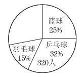

# Mathematics (Grade 6)

**ID**: 3d80759d
**难度**: hard
**题型**: multiple_choice

## 题目
为了了解某校学生对篮球、足球、羽毛球、乒乓球、网球的喜爱，小李采用了抽样调查，在绘制扇形统计图时，由于时间仓促，还有足球、网球等信息没有绘制完成，如图所示，根据图中的信息，这批被抽样调查的学生最喜欢足球的人数不可能是（）

A.100
B.200
C.260
D.400

## 解答

**答案**: D

1. Step1:根据扇形统计图中乒乓球人数为320人，占比32%，计算总人数，即320÷32% = 1000人
2. Step2:根据总人数1000人以及羽毛球占比15%，计算喜欢羽毛球的人数，即1000×15% = 150人
3. Step3:根据总人数1000人以及篮球占比25%，计算喜欢篮球的人数，即1000×25% = 250人
4. Step4:计算喜欢足球和网球的总人数，用总人数减去喜欢乒乓球、篮球、羽毛球的人数，即1000 - 320 - 250 - 150 = 280人
5. Step5:因为喜欢足球和网球总人数为280人，所以喜欢足球的人数不可能超过280人，判断选项中400人不符合，答案为D

## 知识点

**知识点**:
  - 扇形统计图

---
