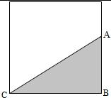

# Mathematics (Grade 6)

**ID**: 4371a7d5
**难度**: hard
**题型**: multiple_choice

## 题目
如图，三角形ABC的面积与正方形面积的比是5：16，正方形的边长是8cm，那么三角形的边AB长是（  ）
$\begin{description}
\item A．3\item B．2.5\item C．5
\end{description}$

## 解答

**答案**: C

1. Step1:根据正方形边长为8cm，由正方形面积公式S=a²（a为边长），可得正方形面积为8×8 = 64cm²
2. Step2:已知三角形ABC的面积与正方形面积的比是5：16，把正方形面积看作单位“1”，则三角形ABC的面积为64×$rac{5}{16}$ = 20cm²
3. Step3:根据三角形面积公式S = $rac{1}{2}$ah（a为底，h为高），此三角形中底为AB，高为BC = 8cm，所以AB的长度为20×2÷8 = 5cm

## 知识点

**知识点**:
  - 三角形面积与底的正比关系．

---
