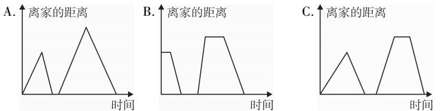

# Mathematics (Grade 6)

**ID**: 4385d260
**难度**: hard
**题型**: multiple_choice

## 题目
小军从家出发去书店买书， 当他走了大约一半路程时，想起忘了带钱，于是他回家取钱，然后再去书店，买了几本书后回家。下面（）幅图比较准确地反映了小军的行为。

## 解答

**答案**: C

1. Step1:分析小军的行为过程，他先出发走了大约一半路程，此时离家距离逐渐增加到全程的一半
2. Step2:然后他想起忘带钱回家，离家距离从全程一半逐渐减少到0
3. Step3:在家取钱时，有一段时间离家距离保持为0
4. Step4:再次出发去书店，离家距离又从0开始逐渐增加到全程
5. Step5:在书店买书期间，有一段时间离家距离保持为全程不变
6. Step6:买完书后回家，离家距离从全程逐渐减少到0
7. Step7:对比各选项，只有C图符合上述小军离家距离随时间的变化情况

## 知识点

**知识点**:
  - 

---
