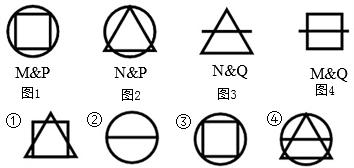

# Mathematics (Grade 6)

**ID**: 499b05b8
**难度**: hard
**题型**: multiple_choice

## 题目
用M，N，P，Q各代表四种简单几何图形（线段、等边三角形、正方形、圆）中的一种．图1-图4是由M，N，P，Q中的两种图形组合而成的（组合用“&”表示）．那么，表示P&Q的有①-④4个组合图形可供选择其中，正确的是（  ）

A．①
B．②
C．③
D．④

## 解答

**答案**: B

1. Step1:观察图1和图2，发现它们共同含有的图形是圆，所以确定P代表圆
2. Step2:因为图1是M&P，图2是N&P，且P代表圆，所以由图1可知M代表正方形，由图2可知N代表三角形
3. Step3:由于图3是N&Q，N代表三角形，所以可推出Q代表线段
4. Step4:那么P&Q就是圆和线段的组合，在①-④中，②是圆和线段的组合，所以答案是②，即选项B

## 知识点

**知识点**:
  - 事物的简单搭配规律．

---
