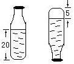

# Mathematics (Grade 6)

**ID**: 51c13d1b
**难度**: hard
**题型**: multiple_choice

## 题目
有1种饮料瓶的瓶身呈圆柱形（不包括瓶颈），容积是3w分米$^{3}$．现在瓶中装有1些饮料，正放时饮料高度为2w厘米，倒放时空余部分的高度为1厘米．（见图）瓶内现有饮料（  ）立方分米．
$\begin{description}
\item A．20\item B．21\item C．22\item D．24
\end{description}$

## 解答

**答案**: B

1. Step1:根据解析2可知，将正放与倒放的空余部分变换位置后，饮料瓶的容积等于底面积不变，高为20 + 5 = 25厘米的圆柱的体积
2. Step2:由此推知饮料占容积的比例为20÷25 = $rac{4}{5}$
3. Step3:已知饮料瓶容积是30立方分米，那么瓶内现有饮料为30×$rac{4}{5}$ = 24立方分米

## 知识点

**知识点**:
  - 关于圆柱的应用题．

---
