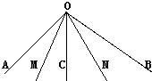

# Mathematics (Grade 6)

**ID**: 51fd1fd0
**难度**: hard
**题型**: multiple_choice

## 题目
已知∠AOB=1rr°，OC为一条射线，射线OM、ON分别平分∠BOC和∠AOC，那么∠MON等于（  ）度．
$\begin{description}
\item A．50\item B．25\item C．45\item D．75
\end{description}$

## 解答

**答案**: A

1. Step1:根据角平分线的性质，因为射线OM平分∠BOC，所以∠COM = 1/2∠BOC
2. Step2:根据角平分线的性质，因为射线ON平分∠AOC，所以∠CON = 1/2∠AOC
3. Step3:因为∠MON = ∠COM + ∠CON，将∠COM = 1/2∠BOC和∠CON = 1/2∠AOC代入可得∠MON = 1/2∠BOC + 1/2∠AOC
4. Step4:对∠MON = 1/2∠BOC + 1/2∠AOC进行变形，提取公因式1/2，得到∠MON = 1/2(∠BOC + ∠AOC)
5. Step5:因为∠BOC + ∠AOC = ∠AOB，且∠AOB = 100°，所以∠MON = 1/2×100° = 50°
6. Step6:对比选项，发现50°对应的选项是A，所以答案是A

## 知识点

**知识点**:
  - 角的度量．

---
