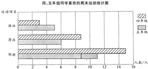

# Mathematics (Grade 6)

**ID**: 52838682
**难度**: hard
**题型**: multiple_choice

## 题目

哪一种结论是正确的？（  ）
A．四年级比五年级有更多的同学喜欢游泳
B．四年级和五年级大部分人都喜欢郊游
C．喜欢郊游的人数，五年级比四年级多
D．喜欢滑冰的人数，五年级是四年级的2倍

## 解答

**答案**: B

1. Step1:根据图例明确浅颜色代表四年级，深颜色代表五年级
2. Step2:分析选项A，对比喜欢游泳的四年级3人和五年级5人，得出四年级人数比五年级少，A错误
3. Step3:分析选项B，观察到四年级和五年级都是郊游人数最多，得出四年级和五年级大部分人都喜欢郊游，B正确
4. Step4:分析选项C，对比喜欢郊游的五年级11人和四年级15人，得出五年级人数比四年级少，C错误
5. Step5:分析选项D，计算喜欢滑冰的五年级6人是四年级9人的6÷9=$\frac{2}{3}$，不是2倍，D错误
6. Step6:综上，正确答案是B

## 知识点

**知识点**:
  - 两种不同形式的复式条形统计图；从统计图表中获取信息．

---
