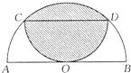

# Mathematics (Grade 6)

**ID**: 52cfd0e2
**难度**: hard
**题型**: multiple_choice

## 题目
如图，曲线ACDB和COD是两个半圆，CD平行于AB，大半圆的半径是1米，那么阴影部分的面积是(  )
A．$\frac{π−1}{2}$
B．$\frac{3π}{4}−\frac{1}{2}$
C．1
D．$\frac{π}{2}$

## 解答

**答案**: A

1. Step1:连接CO和DO，因为大半圆半径为1米，即OC = OD = 1米。由于CD平行于AB，且∠COD = 90°（可由图形对称性等得出），以CD为边长的正方形面积为2平方米，根据正方形面积公式可得CD² = 2，那么($\frac{1}{2}CD$² = $\frac{1}{2}$，此为下面阴影部分半圆半径的平方。
2. Step2:计算下面阴影部分半圆的面积，根据圆的面积公式S = πr²，这里r² = $\frac{1}{2}$，所以半圆面积为$\frac{1}{2}×π×\frac{1}{2}=\frac{1}{4}π$平方米。
3. Step3:计算上面阴影部分的面积，因为∠COD = 90°，所以上面阴影部分面积等于$\frac{1}{4}$圆的面积减去△COD的面积，$\frac{1}{4}$圆的面积为$\frac{1}{4}×π×1² = \frac{1}{4}π$平方米，△COD的面积为$\frac{1}{2}×1×1 = \frac{1}{2}$平方米，那么上面阴影部分面积为$\frac{1}{4}π - \frac{1}{2}$平方米。
4. Step4:计算阴影部分总面积，将上下两部分阴影面积相加，即$\frac{1}{4}π + \frac{1}{4}π - \frac{1}{2}=\frac{π - 1}{2}$平方米，所以答案选A。

## 知识点

**知识点**:
  - 组合图形的面积．

---
