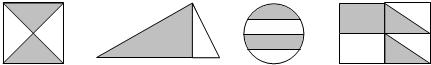

# Mathematics (Grade 6)

**ID**: 53ff2399
**难度**: hard
**题型**: multiple_choice

## 题目
下面图形中能用$\frac{1}{2}$表示涂色部分面积的有（  ）

$\begin{description}
\item A．1个\item B．2个\item C．3个\item D．4个
\end{description}$

## 解答

**答案**: C

1. Step1:分析第一个图形，把正方形平均分成4份，阴影部分占2份，根据分数的计算，2/4 = 1/2，所以该图形阴影部分面积能用1/2表示
2. Step2:分析第二个图形，此三角形不是被平均分成2份，根据分数意义，其阴影部分不能用1/2表示
3. Step3:分析第三个图形，虽未将圆平均分成4份，但阴影部分占整个圆的1/2，所以能用1/2表示
4. Step4:分析第四个图形，把长方形平均分成4份，阴影部分占2份，2/4 = 1/2，所以该图形阴影部分面积能用1/2表示
5. Step5:统计能用1/2表示涂色部分面积的图形个数为3个

## 知识点

**知识点**:
  - 分数的意义、读写及分类．

---
