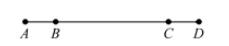

# Mathematics (Grade 6)

**ID**: 56afaf98
**难度**: hard
**题型**: multiple_choice

## 题目
如图，在工作流程线上的A，B，C，D处各有一名工人，现要求在流程线上安放一个工具箱，使4个人到工具箱的距离之和最短，则工具箱应安放在（）。

A.A或D处
B.线段AD上的任意一点
C.线段BC的中点
D.线段BC上的任意一点

## 解答

**答案**: D

1. Step1:明确目标是使4个人到工具箱的距离之和最短
2. Step2:假设工具箱在A处，计算距离和为AB + AC + AD，发现AB + AC + AD＞AD + BC
3. Step3:假设工具箱在D处，计算距离和为AD + BD + CD，发现AD + BD + CD＞AD + BC
4. Step4:假设工具箱在A与B之间，得出距离和＞AD + BC
5. Step5:假设工具箱在B与C之间，得出距离和 = AD + BC
6. Step6:假设工具箱在C与D之间，得出距离和＞AD + BC
7. Step7:比较各种假设情况，发现当工具箱在B与C之间时距离和最小，所以应选D

## 知识点

**知识点**:
  - 直线、射线和线段的认识

---
