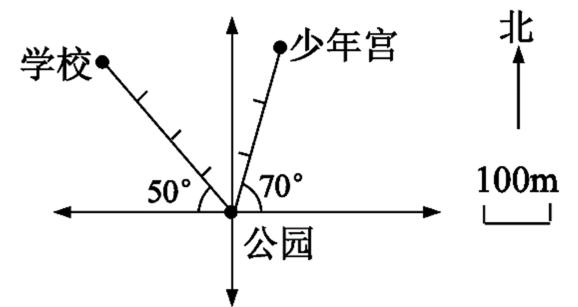

# Mathematics (Grade 6)

**ID**: 56fa6289
**难度**: hard
**题型**: multiple_choice

## 题目
观察下图，下面的说法正确的是（    ）。 

$\begin{description}
\item A.学校在公园北偏西40°方向400m处\item B.少年宫在公园的东偏北20°方向300m处\item C.学校在公园西偏北40°方向400m处\item D.少年宫在公园北偏东70°方向300m处
\end{description}$

## 解答

**答案**: A

1. Step1:根据确定位置的三要素方向、角度、距离来判断各选项。
2. Step2:分析选项A，由图可知学校在公园北偏西40°方向，图中比例尺为100m一格，学校到公园有4格，距离为400m，所以此项说法正确。
3. Step3:分析选项B，由图可知少年宫在公园的北偏东20°方向，不是东偏北20°方向，距离为300m，所以此项说法错误。
4. Step4:分析选项C，由图可知学校在公园西偏北50°方向，不是西偏北40°方向，距离为400m，所以此项说法错误。
5. Step5:分析选项D，由图可知少年宫在公园东偏北70°方向，不是北偏东70°方向，距离为300m，所以此项说法错误。
6. Step6:综上，只有选项A说法正确，答案为A。

## 知识点

**知识点**:
  - 

---
