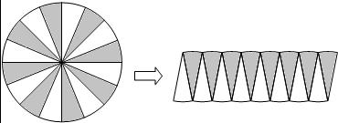

# Mathematics (Grade 6)

**ID**: 58497e8e
**难度**: hard
**题型**: multiple_choice

## 题目
如图，把一个圆平均分成若干份，剪开后拼成一个近似的平行四边形，那么剪拼前后这两个图形的（  ）

$\begin{description}
\item A．面积相等，周长不相等\item B．面积相等，周长也相等\item C．面积不相等，周长相等
\end{description}$

## 解答

**答案**: A

1. Step1:明确将圆平均分成若干份后拼组得到的图形面积特性，即无论怎么拼组，得到的图形面积都等于原来圆的面积，所以拼成的近似平行四边形面积和圆的面积相等
2. Step2:观察拼成的近似平行四边形的周长情况，发现其周长增加了圆的2条半径的长度，所以拼成的平行四边形的周长和圆的周长不相等
3. Step3:根据面积相等和周长不相等的结论，从选项中选择对应的答案A

## 知识点

**知识点**:
  - 图形的拆拼（切拼）．

---
