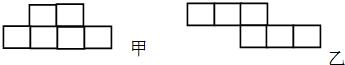

# Mathematics (Grade 6)

**ID**: 5f8bc7dd
**难度**: hard
**题型**: multiple_choice

## 题目
下面的两个图形都是边长1厘米的小正方形拼成的，下面的说法正确的是（  ）

$\begin{description}
\item A．甲、乙的面积相等，周长也相等．\item B．甲、乙的面积相等，乙的周长长\item C．甲、乙的周长相等，乙的面积大．
\end{description}$

## 解答

**答案**: B

1. Step1:计算小正方形面积，因为小正方形边长为1厘米，根据正方形面积公式可得其面积为1×1 = 1平方厘米
2. Step2:计算甲图面积，甲图由6个小正方形组成，所以甲图面积为6×1 = 6平方厘米
3. Step3:计算乙图面积，乙图由6个小正方形组成，所以乙图面积为6×1 = 6平方厘米，由此得出甲、乙面积相等
4. Step4:计算甲图周长，甲图的周长由12个小正方形边长组成，所以甲图周长为12×1 = 12厘米
5. Step5:计算乙图周长，乙图的周长由14个小正方形边长组成，所以乙图周长为14×1 = 14厘米，由此得出乙的周长比甲长
6. Step6:根据面积和周长的比较结果，可知甲、乙的面积相等，乙的周长长，所以答案选B

## 知识点

**知识点**:
  - 面积及面积的大小比较．

---
