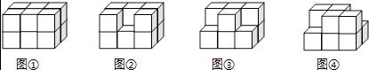

# Mathematics (Grade 6)

**ID**: 5fb3d821
**难度**: hard
**题型**: multiple_choice

## 题目
下面各个立体图形都是由若干个同样大小的立方体拼成的，表面积最大的图形是（ ）

$\begin{description}
\item A．图①\item B．图②\item C．图③\item D．图④
\end{description}$

## 解答

**答案**: B

1. Step1:设每个小正方体的面的面积都是1
2. Step2:计算图①的表面积，其上下、前后都有6个小正方体的面，左右都有4个小正方体的面，所以表面积为6×4 + 4×2 = 32
3. Step3:计算图②的表面积，其上下、前后都有6个小正方体的面，左右都有4个小正方体的面，中间还有2个小正方体的面，所以表面积为6×4 + 4×2 + 2 = 34
4. Step4:计算图③的表面积，其上下、前后都有6个小正方体的面，左右都有4个小正方体的面，所以表面积为6×4 + 4×2 = 32
5. Step5:计算图④的表面积，其上下、前后都有6个小正方体的面，左右都有4个小正方体的面，所以表面积为6×4 + 4×2 = 32
6. Step6:比较四个图形的表面积34＞32，得出表面积最大的是图②，答案选B

## 知识点

**知识点**:
  - 小学数学;图形与几何

---
