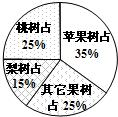

# Mathematics (Grade 6)

**ID**: 63f53de9
**难度**: hard
**题型**: multiple_choice

## 题目
如图是红星果园各种果树栽种情况统计图，根据图中所提供的信息，下面说法中，错误的是（  ）

$\begin{description}
\item A．苹果树棵树最多\item B．梨树棵数最少\item C．桃树与其它果树棵数同样多\item D．统计图只能反映各种果树棵数的百分比，不能确定哪种果树棵数的多和少
\end{description}$

## 解答

**答案**: B

1. Step1:观察统计图可知，把果园果树总数看作单位“1”，苹果树占35%，桃树占25%，梨树占15%，其它果树占25%
2. Step2:分析选项A，35%是所有百分比中最大的，所以苹果树棵树最多，该选项说法正确
3. Step3:分析选项B，虽然梨树占15%，但其它果树占25%，有可能其它果树中的某一种占比小于15%，所以不能确定梨树棵数最少，该选项说法错误
4. Step4:分析选项C，桃树占25%，其它果树也占25%，所以桃树与其它果树棵数同样多，该选项说法正确
5. Step5:分析选项D，统计图呈现的是各种果树棵数的百分比，通过比较百分比大小能确定哪种果树棵数多，该选项说法错误
6. Step6:综上，错误的说法是选项B

## 知识点

**知识点**:
  - 扇形统计图．

---
