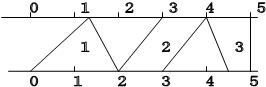

# Mathematics (Grade 6)

**ID**: 646bf086
**难度**: hard
**题型**: multiple_choice

## 题目
下面的图形中，图（  ）的面积最小．

$\begin{description}
\item A．1\item B．2\item C．3
\end{description}$

## 解答

**答案**: C

1. Step1:设梯形、三角形、平行四边形的高都为h
2. Step2:根据三角形面积公式，底为2，可得其面积为2×h÷2 = 1h
3. Step3:根据平行四边形面积公式，底为1，可得其面积为1×h = 1h
4. Step4:根据梯形面积公式，上底是1、下底是0.5，可得其面积为(0.5 + 1)×h÷2 = 0.75h
5. Step5:比较1h、0.75h的大小，得出1h＞0.75h
6. Step6:得出图3梯形的面积最小，答案选C

## 知识点

**知识点**:
  - 面积及面积的大小比较．

---
