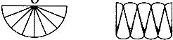

# Mathematics (Grade 6)

**ID**: 65a4b1bc
**难度**: hard
**题型**: multiple_choice

## 题目
“转化”是一种常用的解决问题的方法，下图把一个半圆分成若干等份，后拼成一个近似的长方形，这两个图形（  ）
$\begin{description}
\item A．面积相等，周长也相等\item B．面积相等，周长不相等\item C．面积不相等，周长也不相等
\end{description}$

## 解答

**答案**: A

1. Step1:明确半圆转化为近似长方形的特点，即近似长方形的长等于圆周长的四分之一，宽等于圆的半径
2. Step2:假设圆的半径为1厘米
3. Step3:根据半圆周长公式计算半圆的周长，即3.14×2×1÷2 + 1×2 = 3.14 + 2 = 5.14厘米
4. Step4:根据半圆面积公式计算半圆的面积，即3.14×1×1÷2 = 1.57平方厘米
5. Step5:计算长方形的长，即3.14×2×1÷4 = 1.57厘米，宽为1厘米
6. Step6:根据长方形周长公式计算长方形的周长，即(1.57 + 1)×2 = 5.14厘米
7. Step7:根据长方形面积公式计算长方形的面积，即1.57×1 = 1.57平方厘米
8. Step8:比较半圆和长方形的周长与面积，得出周长相等，面积也相等，所以答案选A

## 知识点

**知识点**:
  - 面积及面积的大小比较．

---
