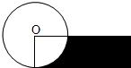

# Mathematics (Grade 6)

**ID**: 6ca3616e
**难度**: hard
**题型**: multiple_choice

## 题目
如图，长方形的面积与圆的面积相等，已知阴影部分的面积是84.上8cm$^{2}$，圆的周长是（  ）cm．
$\begin{description}
\item A．18.84\item B．75.36\item C．37.68
\end{description}$

## 解答

**答案**: C

1. Step1:根据已知阴影部分面积是84.78cm²，且阴影部分面积是圆面积的\(rac{3}{4}\)，所以圆的面积为84.78÷\(rac{3}{4}\) = 113.04cm²
2. Step2:已知圆的面积公式为\(S = \pi r²\)，由圆面积113.04cm²和\(\pi = 3.14\)，可得\(r² = 113.04÷3.14 = 36cm²\)，进而得出半径\(r = 6cm\)
3. Step3:根据圆的周长公式\(C = 2\pi r\)，\(\pi = 3.14\)，半径\(r = 6cm\)，可得圆的周长\(C = 3.14×6×2 = 37.68cm\)

## 知识点

**知识点**:
  - 等积变形（位移、割补）；圆、圆环的周长；圆、圆环的面积．

---
